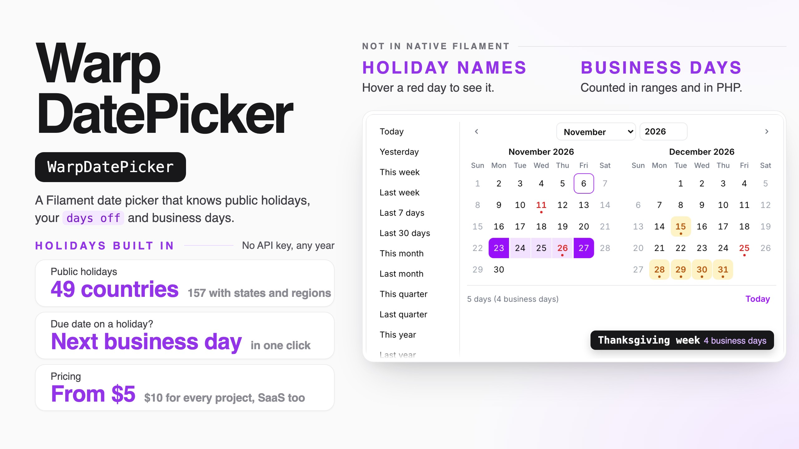

# Warp DatePicker

**A date and time picker for Filament that knows when you are closed. It shows the public holidays of 49 countries (and their states and regions) by name, your company's own days off and business hours, and how many business days — or business hours — away a date is. It can warn about a day off or a closed hour, offer the next business day or opening time with one click, or refuse it. Up to 12 months at once, ranges with quick picks, table columns and filters, and the same counting in PHP and Carbon.**

<a href="https://demo.warpui.com/datepicker"></a>

Pick Christmas as a due date and take the business day it suggests, add a company day off on a calendar of the whole year, and filter orders down to the ones due on a holiday — at **[demo.warpui.com/datepicker](https://demo.warpui.com/datepicker)**. No sign-up needed; the data is reset every hour.



- [What it does](#what-it-does)
- [Installation](#installation)
  - [AI coding assistants (Laravel Boost)](#ai-coding-assistants-laravel-boost)
- [Quick start](#quick-start)
- [The date picker](#the-date-picker)
- [Days off: warn, suggest or refuse](#days-off-warn-suggest-or-refuse)
- [Business days from today](#business-days-from-today)
- [Business hours](#business-hours)
- [The date and time picker](#the-date-and-time-picker)
  - [Ways to pick a time](#ways-to-pick-a-time)
  - [Typing a time](#typing-a-time)
  - [Times outside business hours](#times-outside-business-hours)
  - [Business hours from now](#business-hours-from-now)
  - [Deadlines that follow another field](#deadlines-that-follow-another-field)
  - [Your own data on the times](#your-own-data-on-the-times)
  - [Time zones](#time-zones)
  - [Date and time ranges](#date-and-time-ranges)
- [Table column: business hours left](#table-column-business-hours-left)
- [Filter by business hours](#filter-by-business-hours)
- [Business hours in your own code](#business-hours-in-your-own-code)
- [Next business time for your website](#next-business-time-for-your-website)
- [“Open now” in the top bar](#open-now-in-the-top-bar)
- [Dates that follow another field](#dates-that-follow-another-field)
- [Payment terms](#payment-terms)
- [Your own data on the calendar](#your-own-data-on-the-calendar)
- [Several months at once](#several-months-at-once)
- [Ranges](#ranges)
- [Quick picks (presets)](#quick-picks-presets)
- [Table filter](#table-filter)
- [Table column: business days left](#table-column-business-days-left)
- [Countries, states and working days](#countries-states-and-working-days)
- [Company days off](#company-days-off)
- [The company calendar page](#the-company-calendar-page)
- [A calendar for each place](#a-calendar-for-each-place)
- [Subscribing in a calendar app](#subscribing-in-a-calendar-app)
- [Business days in your own code](#business-days-in-your-own-code)
- [Carbon: `now()->addBusinessDays(3)`](#carbon-nowaddbusinessdays3)
- [Typing a date](#typing-a-date)
- [Testing](#testing)
- [Plugin options](#plugin-options)
- [Multi-tenancy](#multi-tenancy)
- [Commands](#commands)
- [Requirements](#requirements)

## What it does

- **Public holidays by name.** 49 countries and 157 calendars with their states and regions (`US`, `JP`, `DE-BY`, `GB-SCT`, `CA-QC`, `ES-CT`…), worked out on your server for any year. No API key, no request to another service — a lost connection can never make the holidays disappear. Japan uses the Cabinet Office list shipped with the plugin (with one-off days such as an enthronement), and Yasumi for the years after it; a new list or a newly announced holiday arrives with `composer update`, so there is nothing to download yourself. Hover a red day to see its name.
- **Your own days off.** The year-end break, a founding day, an inventory count: in code, on the **Company calendar** page (one per team in a SaaS), or read from a shared iCal link such as a Google Calendar.
- **Business days.** "5 business days from today" under the field, a minimum lead time ("2 business days to pack"), the number of days and business days in a range, and `addBusinessDays()` in PHP.
- **Days off handled the way you want.** Only show them, warn, offer the next business day with one click, or refuse them — refused days are checked on the server too.
- **1 to 12 months at once.** One month, two side by side for ranges, or a whole year that stays open.
- **A drop-in replacement.** `WarpDatePicker` extends Filament's own `DatePicker`: `minDate()`, `maxDate()`, `disabledDates()`, `format()`, `displayFormat()`, `required()` and the rest keep working.
- **Ranges and table filters.** Quick picks like *Last month* and *This fiscal year*, ranges saved into two columns, and a filter that can keep only business days or only days off.
- **Payment terms.** *Net 30*, *end of next month*, *closes on the 20th, paid on the 10th* — the due date fills itself in when the invoice date changes, and moves to the business day before or after when it falls on a day off.
- **Your own data on the days.** *2 left* under a delivery slot, *Fully booked* days that can't be picked, and a date that must be at least 2 business days after the order date.
- **"3 business days left" in tables.** A date column with a colored count that turns amber when the day is close and red when it is late.
- **A calendar for each place.** A warehouse open on Saturdays, a shop with its own days off, a Saturday you work: one panel, several calendars.
- **Subscribe in Google Calendar or Outlook.** The company days off as a link calendar apps can read.
- **Business hours.** 9:00–17:00 with a lunch break, Saturday mornings, shorter hours before a holiday, a half day off for a stocktake, a 15:00 cut-off — in code or painted on the company calendar page, per place and in its own time zone.
- **A date and time picker.** Times beside the calendar as buttons, lists or a clock face; closed times gray; *Use Mon 1:00 PM instead*; 4 business hours from now at the earliest; *2/3* booked and full times; deadlines like *8 business hours after it came in*; other time zones under the field; times that don't exist on a clock-change day refused.
- **"3 hours left" in tables.** A date-and-time column counting business hours, an *Outside business hours* tag, and a filter for orders that came in after hours.
- **Carbon.** `now()->addBusinessDays(3)`, `now()->addBusinessHours(4)`, `$date->isBusinessDay()` and friends, with your holidays, days off and hours.
- **For your website.** A signed JSON link with the next opening time and the earliest delivery, and an *Open now* badge in the panel.
- **Ten languages**, with dates, month and weekday names written the way each language writes them.

## Installation

> **Warp DatePicker is a commercial plugin.** A license is required. After purchase you receive credentials for the private Composer repository.

```bash
composer config repositories.qalainau composer https://qalainau.privato.pub/composer
composer config --auth http-basic.qalainau.privato.pub "your-email" "your-license-key"

composer require qalainau/filament-warp-datepicker
php artisan filament:assets
```

Only if you keep company days off in the database (`storesClosures()`, see [Company days off](#company-days-off)), run `php artisan migrate` too. It creates four tables — `warp_datepicker_closed_days`, `warp_datepicker_calendar_feeds`, `warp_datepicker_business_hours` and `warp_datepicker_link_keys` (the keys of the [subscription links](#subscribing-in-a-calendar-app)); your tables are not changed. To edit the migration, publish it first with `php artisan vendor:publish --tag=filament-warp-datepicker-migrations`.

> Run `php artisan filament:assets` again after every update of the package.

### AI coding assistants (Laravel Boost)

Warp DatePicker ships instructions for AI coding assistants such as Claude Code, Cursor and Codex. If your app uses
[Laravel Boost](https://laravel.com/docs/boost), the assistant learns how to use Warp DatePicker from them: that
`WarpDatePicker` replaces `DatePicker`, that holidays and business days come from the plugin (no extra package, no
weekday arithmetic), what is easy to get wrong, and how to test date fields.

- **Guidelines** (`resources/boost/guidelines/core.md`): a short summary that Boost adds to `CLAUDE.md`,
  `AGENTS.md` and the other agent files. It also points the assistant to this README in `vendor/`, so it reads the
  documentation of the version you have installed instead of guessing.
- **Skill** `warp-datepicker-development` (`resources/boost/skills/`): the steps for adding a date field, business days in
  PHP, the table column and filter, and feature and browser tests. The assistant loads it when it works on dates.

Boost does not add guidelines of other vendors' packages on its own. When `php artisan boost:install` asks
"Which third-party AI guidelines/skills would you like to install?", select `qalainau/filament-warp-datepicker`. To do
it without the question, add the package to `boost.json` and run the command again:

```json
{
    "packages": ["qalainau/filament-warp-datepicker"]
}
```

```bash
php artisan boost:install --guidelines --skills -n
```

## Quick start

1. Tell the panel which country's holidays to use:

```php
use Qalainau\FilamentWarpDatePicker\FilamentWarpDatePickerPlugin;

$panel->plugin(
    FilamentWarpDatePickerPlugin::make()
        ->country('US')
);
```

2. Use `WarpDatePicker` where you used `DatePicker`:

```php
use Qalainau\FilamentWarpDatePicker\Enums\DayOff;
use Qalainau\FilamentWarpDatePicker\Forms\WarpDatePicker;

WarpDatePicker::make('due_on')
    ->required()
    ->onDayOff(DayOff::Suggest)        // a holiday or weekend? offer the next business day
    ->minBusinessDaysFromToday(2)      // we need 2 business days to pack
    ->showBusinessDaysFromToday();     // "4 business days from today" under the field
```

That's all. The value is saved as `Y-m-d`, like Filament's date picker.

## The date picker

`WarpDatePicker` is Filament's `DatePicker` with its own calendar. Everything you know from `DatePicker` keeps its meaning:

```php
WarpDatePicker::make('starts_on')
    ->label('Start date')
    ->required()
    ->minDate(now())
    ->maxDate(now()->addYear())
    ->disabledDates(['2026-12-24'])
    ->displayFormat('d/m/Y')           // PHP date() letters; leave it out to write dates the way the language does
    ->format('Y-m-d')                  // how the value is saved
    ->firstDayOfWeek(1)                // 0 = Sunday … 6 = Saturday; by default the country's habit
    ->locale('de')                     // by default the app's language
    ->months(2)
    ->inline();                        // keep the calendar open under the field
```

In the calendar:

- **Red** days are public holidays, with a dot. Their name shows in the line under the months when you hover or focus them, and screen readers read it.
- **Amber** days are company days off.
- **Grey** days are not working days (by default Saturday and Sunday).
- With a Japanese calendar (`country('JP')`), Saturdays are blue and Sundays red, as on Japanese calendars.
- **Today** has a ring; a crossed-out day can't be picked.

Without `displayFormat()`, the field shows the date the way the user's language writes it — *Fri, Nov 6, 2026*, *Fr., 6. Nov. 2026*, *2026年11月6日(金)*. The colors are CSS variables (`--fi-warp-date-holiday`, `--fi-warp-date-closure`, `--fi-warp-date-saturday`, `--fi-warp-date-accent`…) that you can set in your theme.

## Days off: warn, suggest or refuse

A *day off* is a public holiday, a company day off or a weekday that is not a working day. `onDayOff()` decides what happens when someone picks one:

| `DayOff::` | In the calendar | After picking a day off | On save |
| --- | --- | --- | --- |
| `Allow` (default) | Colors and names only | Nothing | Saved |
| `Warn` | Same | Under the field: *Fri, Dec 25 is Christmas, a public holiday.* | Saved |
| `Suggest` | Same | The same text and a button: **Use Mon, Dec 28 instead** | Saved (the user decides) |
| `Disallow` | Days off are crossed out | A typed day off is refused with a message | Refused by the `BusinessDay` rule |

The suggested day is the next business day, so it skips weekends, holidays and company days off together (with a year-end break from 28 to 31 December, Christmas becomes Monday 4 January: past the weekend, the break and New Year's Day).

```php
WarpDatePicker::make('delivery_on')->onDayOff(DayOff::Disallow);
```

The rule also works on its own, in a form request or anywhere you validate:

```php
use Qalainau\FilamentWarpDatePicker\Rules\BusinessDay;

'due_on' => ['required', 'date', new BusinessDay],                                       // the panel's calendar
'ships_on' => ['required', 'date', new BusinessDay(HolidayCalendar::make()->country('DE'))],
```

## Business days from today

```php
WarpDatePicker::make('due_on')
    ->minBusinessDaysFromToday(2)
    ->showBusinessDaysFromToday();
```

- `minBusinessDaysFromToday(2)`: today and the next business day can't be picked. On a Friday before a long weekend, the first day you can pick moves with it. `0` means today, or the next business day if today is a day off. It is checked on the server too (`after_or_equal`). Pass a closure to use it only sometimes, for example only when creating: `->minBusinessDaysFromToday(fn (string $operation) => $operation === 'create' ? 2 : null)` — so an old order with a past due date can still be saved.
- `showBusinessDaysFromToday()`: under the field, *Today*, *4 business days from today* or *3 business days ago*. Today itself isn't counted; the chosen day is, if it is a business day.

*Today* is today on the clock of the business hours — the `timezone()` of the plugin or of the place in `calendars()`, or the app's time zone without one — the same clock as `cutoff()`, so the first day you can pick and *N business days from today* always agree, even late at night. A field with its own `timezone()`, and the date and time pickers, use their own clock. Quick picks such as *Today* and *This month* and the *business days left* of `WarpDateColumn` / `WarpDateEntry` count from the same today.

## Business hours

Business days tell you *which days* you work. Business hours tell you *when*: 9:00 to 17:00 with a lunch break, Saturday mornings, 15:00 before a public holiday. Give them to the panel once, and every time picker, deadline and count uses them.

```php
FilamentWarpDatePickerPlugin::make()
    ->country('US')
    ->timezone('America/New_York')            // the clock the hours are in; default: the app's time zone
    ->businessHours('09:00', '17:00')         // every business day
    ->businessHours([6 => '09:00-12:00'])     // Saturday mornings (add 6 to workingDays())
    ->workingDays([1, 2, 3, 4, 5, 6])
    ->breaks('12:00', '13:00')                // the lunch break, every day
    ->hoursBeforeHolidays('09:00', '15:00')   // the day before a public holiday or a company day off
    ->hoursOn(['2026-12-31' => '09:00-12:00'])
    ->closedHours([['date' => '2026-11-20', 'hours' => '13:00-17:00', 'name' => 'Stocktaking']])
    ->cutoff('15:00');                        // orders after 15:00 count from the next business day
```

- **`businessHours()`** takes `'09:00', '17:00'`, `'09:00-17:00'`, a list for a day with several openings (`[['08:00', '12:00'], ['13:00', '17:00']]`) or weekdays: `['default' => '09:00-17:00', 6 => '09:00-12:00', 3 => '13:00-17:00']` (ISO weekdays, 1 = Monday). Call it again to change some weekdays only. `'24:00'` closes at midnight.
- Which days are business days is still decided by `workingDays()`, holidays and company days off. Hours only say when you are open on those days.
- **`breaks()`** is taken out of every day, special days too.
- **`hoursBeforeHolidays()`**: on the business day before a public holiday or a company day off (not before a normal weekend).
- **`hoursOn()`**: `[Y-m-d => hours]` or `fn (CarbonImmutable $from, CarbonImmutable $to) => [...]`, called once per year. It has no effect on a day off.
- **`closedHours()`**: a half day off — the day stays a business day, only those hours are closed. Give `'date'` and `'hours'`, or `'starts_at'` and `'ends_at'` (it can run over several days; it is split by the calendar's clock). Or a closure, like `closures()`.
- **`cutoff()`**: on a business day after this time, *N business days from today* counts from the next business day (*orders before 15:00 ship today*). It is used by `minBusinessDaysFromToday()` and `addBusinessDaysFromNow()`. On a day off it changes nothing — a Saturday order already counts from Monday.
- **`timezone()`** is the clock of the business hours. People in other time zones see the same hours in their own clock (9:00 in New York is 15:00 in Berlin).
- Without `businessHours()`, a business day is open from 0:00 to 24:00, so everything below still works and counts whole days.
- Hours close after they open; `'22:00-06:00'` is refused with a message. For a night shift, give `'22:00-24:00'` to one day and `'00:00-06:00'` to the next with `hoursOn()`.

A place can have its own hours and clock in `calendars()`:

```php
->calendars([
    'boston' => 'Boston warehouse',
    'west' => [
        'label' => 'Los Angeles warehouse',
        'timezone' => 'America/Los_Angeles',
        'workingDays' => [1, 2, 3, 4, 5, 6],
        'businessHours' => ['default' => '08:00-17:00', 6 => '08:00-12:00'],
        'cutoff' => '14:00',
    ],
])
```

Each place can set `timezone`, `businessHours`, `breaks`, `hoursBeforeHolidays`, `hoursOn`, `closedHours` and `cutoff`; what it leaves out is the panel's.

**On the company calendar page** (`storesClosures()`), the office can paint the business hours on a week of 30-minute boxes — drag to paint, drag again to clear — for the whole company or one place. Painted hours replace `businessHours()`, `breaks()` and `workingDays()` from the code for that calendar (days with no hours are closed); *Go back to the hours set in the code* removes them. A day off can also be for part of the day: turn off *All day* and give the hours (*Stocktaking, 13:00–17:00*). A working day with hours is a Saturday you work only in the morning.

## The date and time picker

`WarpDateTimePicker` is Filament's `DateTimePicker` with the same calendar, and the times beside it:

```php
use Qalainau\FilamentWarpDatePicker\Enums\DayOff;
use Qalainau\FilamentWarpDatePicker\Forms\WarpDateTimePicker;

WarpDateTimePicker::make('pickup_at')
    ->required()
    ->businessHoursOnly(DayOff::Suggest)     // outside business hours? offer the next opening time
    ->minBusinessHoursFromNow(4)             // we need 4 business hours to get it ready
    ->minutesStep(30)
    ->showBusinessHoursFromNow();            // "6 hours 30 minutes of business hours from now"
```

- Click a day, then a time. The day keeps the time you had; the first time is the day's opening time.
- Times outside business hours are **gray with a dashed border**, and the opening hours of the day are written above them (*Open: 9:00 AM–12:00 PM, 1:00 PM–5:00 PM*). A half day off is shown with its name.
- Everything from `WarpDatePicker` works: `onDayOff()`, `minBusinessDaysFromToday()`, `fillFrom()`, `unavailableDates()`, `calendar('west')`, `months()`, `inline()`…
- The value is `Y-m-d H:i:s` in the field's `timezone()` (by default the user's, through Filament's `FilamentTimezone`) and is saved in the app's time zone, like Filament's `DateTimePicker`. Seconds are always `00`.
- *Now* picks the current time, rounded up to the step.

### Ways to pick a time

```php
use Qalainau\FilamentWarpDatePicker\Enums\TimeInput;

WarpDateTimePicker::make('starts_at')->timeInput(TimeInput::Slots);       // buttons: 9:00, 9:15, 9:30… (default)
WarpDateTimePicker::make('starts_at')->timeInput(TimeInput::Dropdowns);   // hour and minute lists
WarpDateTimePicker::make('starts_at')->timeInput(TimeInput::Clock);       // a clock face: the hour, then the minutes

WarpDateTimePicker::make('starts_at')
    ->minutesStep(15)                       // default 15
    ->timeRange('07:00', '21:00')           // the times shown; default: the business hours, or 0–24 without them
    ->defaultTime('09:00')                  // the time a clicked day gets when nothing was chosen
    ->favoriteTimes(['10:00', '14:00'])     // buttons above the list
    ->dayParts()                            // Morning 9–12, Afternoon 12–17, Evening 17–21
    ->dayParts(['Morning' => '08:00-12:00', 'After lunch' => '13:00-15:00'])
    ->hours12(false);                       // 13:30 instead of 1:30 PM; default: the user's language
```

- The clock shows 1–12 with AM/PM in 12-hour languages, and two rings (1–12 outside, 13–00 inside) in 24-hour languages.
- `dayParts()` buttons pick the start of the part and show its hours, for windows like *morning delivery*.

### Typing a time

The field reads a date and a time, or a time alone (for the chosen day, or today):

| Typed | Means |
| --- | --- |
| `11/20 1:30pm`, `2026-11-20 13:30` | 20 November at 13:30 |
| `1330`, `13`, `13.30`, `1:30 p` | 13:30 (13:00) on the chosen day |
| `9am`, `12am` | 9:00, 0:00 |
| `13時半`, `午後1時`, `오후 1시 30분`, `下午1点半`, `14h30` | Japanese, Korean, Chinese and French ways of writing a time |
| `13:30:45` | 13:30 and 45 seconds |

**Values with seconds.** The value is `Y-m-d H:i:s`, like Filament's `DateTimePicker`, and seconds are kept: a saved `created_at` of 10:15:42 shows as *10:15:42*, stays 10:15:42 when the form is saved without touching it, and also when only the day is changed. Picking another time sets the seconds to 0; typing them (`9:05:07`) keeps them. Call `->withoutSeconds()` to always save `:00`.

### Times outside business hours

`businessHoursOnly()` decides what happens with a time outside business hours. Without it, those times are only gray.

| `DayOff::` | After picking a time outside business hours | On save |
| --- | --- | --- |
| `Allow` | Nothing | Saved |
| `Warn` | *This time is outside business hours.* (or *Closed at this time (Stocktaking).*) | Saved |
| `Suggest` | The same text and a button: **Use Mon, Nov 16 1:00 PM instead** — the next opening time | Saved (the user decides) |
| `Disallow` (default of `businessHoursOnly()`) | The times can't be clicked; a typed one is refused | Refused: *12:30 PM is outside business hours. The next time we are open is Nov 16, 2026 1:00 PM.* |

### Business hours from now

```php
WarpDateTimePicker::make('pickup_at')
    ->minBusinessHoursFromNow(4)
    ->showBusinessHoursFromNow();
```

- `minBusinessHoursFromNow(4)`: the first time you can pick is 4 business hours from now — closed hours, the lunch break, nights, weekends and holidays are not counted. With 9:00–17:00 hours, Friday 16:00 + 4 hours is Monday 12:00. Checked on the server too. `1.5` is an hour and a half.
- `showBusinessHoursFromNow()`: *6 hours 30 minutes of business hours from now* under the field.

### Deadlines that follow another field

`fillFrom()` takes `TimeTerms` for deadlines with a time:

```php
use Qalainau\FilamentWarpDatePicker\TimeTerms;

WarpDateTimePicker::make('received_at'),
WarpDateTimePicker::make('reply_by')->fillFrom('received_at', TimeTerms::businessHours(8)),          // 8 business hours later
WarpDateTimePicker::make('ships_by')->fillFrom('received_at', TimeTerms::sameDayBy('17:00')),        // today at 17:00, or the next business day if it came in later
WarpDateTimePicker::make('call_back_by')->fillFrom('received_at', TimeTerms::nextBusinessDayBy('12:00')), // the next business day by noon
WarpDateTimePicker::make('visit_at')->fillFrom('received_at', TimeTerms::businessDaysAt(2, '10:00')),    // 2 business days later at 10:00
```

Change *Received* and the deadline follows in the browser, with the same answer as `$terms->dueAt($receivedAt, WarpDate::calendar())` in PHP. `PaymentTerms` and a number of business days still work: the date follows and the time stays.

### Your own data on the times

```php
WarpDateTimePicker::make('pickup_at')
    ->slotCounts(fn (CarbonImmutable $date): array => Pickup::query()
        ->whereBetween('pickup_at', [$date->utc(), $date->endOfDay()->utc()])   // pickups are saved in UTC
        ->get()
        ->countBy(fn (Pickup $pickup): string => $pickup->pickup_at->setTimezone($date->timezone)->format('H:i'))
        ->all(), capacity: 3)
    ->timeLabels(fn (CarbonImmutable $date): array => ['10:00' => 'Driver: Sam'])
    ->unavailableTimes(fn (CarbonImmutable $date): array => $date->isFriday() ? ['16:30' => 'Last truck has left'] : []);
```

- `slotCounts()` returns `['H:i' => count]` for the day (`$date` is the day in the field's time zone). With a `capacity`, each time shows *2/3* and fills from the bottom; a full time can't be picked or saved. The time the record already has stays valid, so an existing booking can be saved again.
- `timeLabels()` writes a small text under the time; `unavailableTimes()` crosses times out with a reason (a list of times works too). Both can be arrays.
- The closures run for the chosen day when the picker opens and for each day clicked afterwards.

### Time zones

```php
WarpDateTimePicker::make('call_at')->alsoShowTimezones(['Europe/London' => 'London', 'Asia/Tokyo' => 'Tokyo']);
```

- Under the field: *London: 12:00 AM*, *Tokyo: Sat, Nov 21 9:00 AM* — with the date when it is another day there.
- When the user's computer is in another time zone than the field, *Your time: Sat, Nov 21 3:30 AM* is added by itself.
- The business hours are in their calendar's clock, so a Los Angeles warehouse shows 8:00–17:00 Los Angeles time to a user in New York as 11:00–20:00.
- **Clock changes (daylight saving time).** On the day the clocks go forward, the skipped times (2:00–2:59 in New York on 8 March 2026) don't exist; on the day they go back, 1:00–1:59 comes twice. Both are crossed out with the reason and refused on save, so a saved time always means one moment. Business hours and counts follow the wall clock of the place on those days (a 1:00–5:00 day is 3 hours long when the clocks go forward).

### Date and time ranges

```php
use Qalainau\FilamentWarpDatePicker\Forms\WarpDateTimeRangePicker;

WarpDateTimeRangePicker::make('job')
    ->fields('starts_at', 'ends_at')
    ->durations([60, 120, 480])            // "1 hour", "2 hours", "8 hours" from the start
    ->durationsInBusinessHours();          // count them in business hours (Friday 16:00 + 2 hours = Monday 10:00)
```

- Pick the first and the last day, then the start and the end time (the *First day* / *Last day* buttons switch which end the times change).
- Under the field: *2 days 3 hours (11 hours of business hours)*.
- **Overnight:** an end time at or before the start time on the same day moves the end to the next day (*22:00 – 6:00* ends the next morning) and says so.
- The value is `['start' => 'Y-m-d H:i:s', 'end' => 'Y-m-d H:i:s']` in the field's time zone; `fields()` saves both columns in the app's time zone. `minutesStep()`, `timeRange()`, `defaultTime()`, `timeInput()` and `hours12()` work as on the single picker.

## Table column: business hours left

```php
use Qalainau\FilamentWarpDatePicker\Tables\WarpDateTimeColumn;

WarpDateTimeColumn::make('reply_by')
    ->doneWhen(fn (Ticket $record): bool => $record->answered_at !== null)
    ->warnWithinHours(2)
    ->timeOnlyForToday();

WarpDateTimeColumn::make('created_at')
    ->businessDaysLeft(false)
    ->markOutsideBusinessHours();
```

- Next to the time: *3 hours 30 minutes left (business hours)* or *2 hours 15 minutes late (business hours)*, counting business hours only. Gray, amber when `warnWithinHours()` or fewer are left (default 4), red when late. From `hoursUntilDays()` business hours (default 24) it says *4 business days left* instead.
- `timeOnlyForToday()`: *Today 3:00 PM* for today and only the date for other days, to keep lists short.
- `markOutsideBusinessHours()`: an *Outside business hours* tag on night, weekend and holiday times — orders that came in after hours.
- The time is shown in the user's time zone like any `dateTime()` column. In infolists: `Qalainau\FilamentWarpDatePicker\Infolists\WarpDateTimeEntry`.

## Filter by business hours

```php
use Qalainau\FilamentWarpDatePicker\Tables\BusinessHoursFilter;

BusinessHoursFilter::make('created_at');                                          // During / Outside business hours / Due before closing today
BusinessHoursFilter::make('reply_by')->kinds([BusinessHoursFilter::DUE_TODAY]);
BusinessHoursFilter::make('ordered')->column('created_at')->calendar('west');
```

- *During business hours* and *Outside business hours (nights, weekends, holidays)* compare each time with the business hours of its own day, so the lunch break and a half day off count as outside.
- *Due before closing today*: from now until today's closing time.
- Inside/outside looks at the 400 days before and after today (`BusinessHoursFilter::DAYS_LIMIT`); older rows are left out of both.

## Business hours in your own code

```php
$calendar = WarpDate::calendar();

$calendar->isOpen(now());                                    // open right now?
$calendar->nextOpen(now());                                  // now if open, otherwise the next opening time
$calendar->closesAt(now());                                  // when the current opening ends, or null
$calendar->openingHours('2026-11-20');                       // [['09:00', '12:00'], ['13:00', '17:00']]
$calendar->closedHoursOn('2026-11-20');                      // [['13:00', '17:00', 'Stocktaking']]
$calendar->addBusinessHours('2026-11-06 16:00', 4);          // Monday 12:00
$calendar->subBusinessHours($ticket->due_at, 2);
$calendar->addBusinessMinutes($ticket->received_at, 90);
$calendar->businessHoursBetween($ticket->received_at, $ticket->answered_at);   // 3.5 = 3 hours 30 minutes
$calendar->businessMinutesBetween($from, $to);
$calendar->countingFrom(now());                              // today, or the next business day after the cut-off
$calendar->addBusinessDaysFromNow(2);                        // 2 business days, after the cut-off from tomorrow
TimeTerms::sameDayBy('17:00')->dueAt(now(), $calendar);

HolidayCalendar::make()
    ->country('DE')
    ->timezone('Europe/Berlin')
    ->businessHours('08:00', '16:30')
    ->addBusinessHours(now(), 8);
```

- A Carbon date keeps its time zone in the answer; a string is read in the calendar's time zone (`'2026-11-06T09:00:00Z'` with a zone is converted).
- `businessMinutesBetween()` and `businessHoursBetween()` are never negative; swap the times if you need the sign, or use the Carbon methods below.
- **Warp Scheduler and Warp Shift** read this calendar directly: `$scheduler->useWarpDatePicker()` (holidays, company days off, business hours and half days off on the board and in its availability rules) and `$roster->useWarpDatePicker()` (the holidays of the roster). See their READMEs.
- `WarpDate::calendar()->toArray(2026, 2027)` gives the whole calendar — country, time zone, working days, days off, opening hours, special and closed hours — to pass to another screen, an API or another Warp plugin.

Carbon gets the same:

```php
now()->addBusinessHours(3);
$ticket->received_at->addBusinessMinutes(90);
$ticket->due_at->subBusinessHours(2);
$ticket->received_at->businessHoursUntil(now());     // negative when it is in the past
$ticket->received_at->businessMinutesUntil(now());
now()->isWithinBusinessHours();
now()->nextBusinessTime();                           // now, or the next opening time
now()->addBusinessHours(2, 'west');                  // with a calendar for one place
```

## Next business time for your website

Your shop or order form outside Filament can ask for the earliest time:

```php
$url = WarpDate::get()->nextBusinessTimeUrl();          // or nextBusinessTimeUrl('west'); belongs to the current team
```

```bash
curl "$url&hours=4"   # 4 business hours from now
curl "$url&days=2"    # 2 business days from now, after the cut-off from the next business day
```

```json
{
    "timezone": "America/New_York",
    "now": "2026-11-06T16:20:00-05:00",
    "is_open": true,
    "closes_at": "2026-11-06T17:00:00-05:00",
    "next_open": "2026-11-06T16:20:00-05:00",
    "cutoff": "15:00",
    "earliest": "2026-11-09T13:20:00-05:00",
    "earliest_date": "2026-11-09",
    "opening_hours_today": [["09:00", "12:00"], ["13:00", "17:00"]]
}
```

The link is signed like the calendar link: anyone with it can read the answer without signing in, and nothing else. `hours` and `days` are not part of the signature, so one link serves every lead time (`hours` up to 10,000, `days` up to 1,000 business days). It has its own key: `WarpDate::get()->renewNextBusinessTimeUrl()` makes a new link and stops the old one, without touching the calendar subscription links (and *Make a new link* on the page does not stop this one). It can be called 600 times a minute from one IP address, because your shop's server calls it from one address for every visitor — cache the answer for a minute (it says `Cache-Control: max-age=60`) or change the limit with `RateLimiter::for('warp-datepicker-next-business-time', …)`. With `days`, `earliest` is `null` and `earliest_date` is the day.

## “Open now” in the top bar

```php
FilamentWarpDatePickerPlugin::make()->openNowBadge();          // or openNowBadge(calendar: 'west')
```

A badge next to the user menu says *Open · until 5:00 PM*, *Open · closes in 40 min* (amber in the last hour) or *Closed · opens Mon 9:00 AM*, and changes by itself every 30 seconds. It is hidden on phones. Pass a closure to show it only to some users: `openNowBadge(fn () => auth()->user()->is_support)`.

## Several months at once

```php
WarpDatePicker::make('planned_on')->months(3);            // three months side by side
WarpDatePicker::make('holidays')->months(12)->inline();   // a whole year, January to December, always open
```

`months()` takes 1 to 12. `calendarOnly()` leaves out the text field and keeps just the open calendar, for a page that shows the year and reacts to a click (with `->live()->afterStateUpdated(...)`), like the company calendar page. The months wrap to fit the screen; on a phone they are stacked. With 12 months the calendar starts in January and the arrows move a month at a time. The month and year boxes at the top jump anywhere; holidays of any year are loaded when you get there.

## Ranges

`WarpDateRangePicker` picks a first and a last day. Click the first day, then the last; while you move to the last day, the range and its count show: *5 days (4 business days)*. Clicking the last day before the first is fine — they are swapped.

To change a range, you don't have to pick it again:

- Two buttons above the calendar, **First day** and **Last day**, show the range and which end the next click changes.
- After opening, a click changes the first day. If it is before the last day, the last day stays, the range is saved at once, and *Last day* is next: click another day to change it too, or close the calendar to keep the range.
- Click *Last day* first to change only the last day.
- Clicking past the other end starts a new range there. It is saved when you pick its last day; closing the calendar before that keeps the old range.
- While you move over the calendar, it shows the range a click would make, with its days and business days.

```php
use Qalainau\FilamentWarpDatePicker\Forms\WarpDateRangePicker;

WarpDateRangePicker::make('days_off')
    ->label('Days off')
    ->fields('starts_on', 'ends_on')   // read and save two columns of the model
    ->maxDays(30)
    ->presets(false)                   // no quick picks
    ->required();
```

- **Value.** Without `fields()`, the value is `['start' => 'Y-m-d', 'end' => 'Y-m-d']` (use an `array` or `json` cast). With `fields('starts_on', 'ends_on')`, the two columns are read when the form is filled and written when it is saved, and the field's own name (`days_off`) is not saved.
- `months()` is 2 by default. `minDate()`, `maxDate()`, `maxDays()`, `displayFormat()`, `locale()`, `timezone()`, `firstDayOfWeek()`, `country()`, `workingDays()` and `closures()` work as on the single picker.
- `maxDays(30)` counts the first and the last day; days further away can't be clicked once the first day is chosen, and longer ranges are refused on save.
- `required()` needs both days.

## Quick picks (presets)

Ranges show quick picks on the left (on a phone, above the calendar). The default list looks back — *Today, Yesterday, This week, Last week, Last 7 days, Last 30 days, This month, Last month, This quarter, Last quarter, This year, Last year*. Choose your own:

```php
use Qalainau\FilamentWarpDatePicker\Forms\Preset;

WarpDateRangePicker::make('period')->presets([
    Preset::thisMonth(),
    Preset::lastMonth(),
    Preset::thisFiscalYear(),
    Preset::lastFiscalYear(),
    Preset::make('peak', 'Peak season', fn (CarbonImmutable $today) => [$today->setDate($today->year, 7, 1), $today->setDate($today->year, 8, 31)]),
]);
```

All presets: `today()`, `yesterday()`, `thisWeek()`, `lastWeek()`, `nextWeek()`, `last7Days()`, `last30Days()`, `next7Days()`, `next30Days()`, `thisMonth()`, `lastMonth()`, `nextMonth()`, `thisQuarter()`, `lastQuarter()`, `thisYear()`, `lastYear()`, `thisFiscalYear()`, `lastFiscalYear()`. Rename one with `->label('…')`.

- Weeks start on the picker's first day of the week.
- The fiscal year starts in the month you give the plugin: `fiscalYearStartMonth(4)` for April (most Japanese and Indian companies), `7` for July. *This fiscal year* on 10 February 2027 with April is 1 April 2026 – 31 March 2027.
- Presets are worked out on the server from the same today as the calendar (see [Business days from today](#business-days-from-today)), so they never shift by a day in the browser.
- In `Preset::make()`, the closure can also take `$firstDayOfWeek` and `$fiscalYearStartMonth` by name.

## Table filter

```php
use Qalainau\FilamentWarpDatePicker\Tables\WarpDateRangeFilter;

->filters([
    WarpDateRangeFilter::make('ordered_on')
        ->label('Ordered')
        ->picker(fn (WarpDateRangePicker $picker) => $picker->presets([Preset::thisFiscalYear(), Preset::lastFiscalYear()])),
    WarpDateRangeFilter::make('due_on')
        ->label('Due')
        ->dayKinds(),
])
```

- The filter keeps the rows whose column is inside the range (both days included). `date` and `datetime` columns both work. The column is the filter's name; use `column('…')` for another.
- `dayKinds()` adds a choice: *All days*, *Business days only*, *Days off only (holidays and weekends)* — for example, to find the orders that are due on a holiday. It works on ranges up to 400 days.
- The active filter shows as *Ordered: Jul 1, 2026 – Jun 30, 2027*.
- `picker()` gets the `WarpDateRangePicker` in the filter, to change its presets, months, country and so on.

## Dates that follow another field

```php
WarpDatePicker::make('ordered_on')->required(),

WarpDatePicker::make('ships_on')
    ->minBusinessDaysAfter('ordered_on', 2),       // 2 business days after the order date, or later

WarpDatePicker::make('payment_due_on')
    ->fillFrom('ordered_on', PaymentTerms::net(30)),  // filled in when the order date changes
```

- `minBusinessDaysAfter('ordered_on', 2)`: days before the second business day after the other field's date can't be picked. Change the order date and the calendar follows at once, without a request to the server. It is checked on the server too, with a message that says the first day allowed. `0` means the other field's day itself (or the next business day if it is a day off). If the other field is empty, nothing is limited.
- `fillFrom('ordered_on', 3)`: when the other field changes, this one gets the date 3 business days later. Pass `PaymentTerms` for a due date (next section). The user can still change the date afterwards. When the page opens with this field empty and the other one filled — a new record with a default order date — it is filled at once.
- The field name is relative, like `$get()`: `'ordered_on'` for a field next to this one, `'../ordered_on'` from inside a repeater item.
- Both work in the browser, so the other field doesn't need `live()`.
- Terms that depend on another field — the supplier's or the customer's — can be a closure: `->fillFrom('purchased_on', fn (Get $get): ?PaymentTerms => Supplier::find($get('supplier_id'))?->paymentTerms())`. Give the field it reads `live()`. When the terms change, the field is filled again with the new terms; `null` terms fill nothing. A closure for the days of `minBusinessDaysAfter()` works the same way.
- `fillFrom()` fills the field **in the browser**, while someone uses the form. Records made in code, imports and API calls get no date from it: work the date out with [`PaymentTerms`](#payment-terms) there (`PaymentTerms::net(30)->dueDate($order->ordered_on, WarpDate::calendar())`).

## Payment terms

`PaymentTerms` works out a due date from an invoice or order date, and moves it when it falls on a day off:

```php
use Qalainau\FilamentWarpDatePicker\Enums\Roll;
use Qalainau\FilamentWarpDatePicker\PaymentTerms;

PaymentTerms::net(30);                                    // 30 days later (Net 30)
PaymentTerms::businessDays(5);                            // 5 business days later
PaymentTerms::endOfMonth();                               // end of the next month
PaymentTerms::endOfMonth(monthsLater: 2);                 // end of the month after next
PaymentTerms::endOfMonth(monthsLater: 0);                 // end of the same month
PaymentTerms::monthly(closingDay: 20, paymentDay: 10);    // closes on the 20th, paid on the 10th of the next month
PaymentTerms::monthly(closingDay: 25, paymentDay: 31, monthsLater: 1)->roll(Roll::Preceding);
```

- **Monthly terms.** An invoice dated on or before the closing day belongs to that month; after it, to the next month. The payment is `monthsLater` months after that, on `paymentDay`. A day of 31 (or more) is the end of the month — 28 or 29 in February.
- **When the due date is a day off**, `roll()` decides where it goes:

| `Roll` | The day off moves to |
| --- | --- |
| `Following` (default) | the next business day |
| `Preceding` | the business day before |
| `ModifiedFollowing` | the next business day, unless that is in the next month — then the business day before (a month-end payment stays in its month) |
| `ModifiedPreceding` | the business day before, unless that is in the previous month — then the next business day |
| `None` | nowhere: the day off stays |

- Use it in a field with `fillFrom()`, or in PHP:

```php
$terms = PaymentTerms::endOfMonth()->roll(Roll::Preceding);

$terms->dueDate($invoice->issued_on, WarpDate::calendar());   // CarbonImmutable
WarpDate::calendar()->dueDate($invoice->issued_on, $terms);   // the same
WarpDate::calendar()->roll('2026-12-31', Roll::Preceding);    // just move a day off
```

The browser and PHP work out the same dates (they are tested against each other), so what the user sees is what you save.

## Your own data on the calendar

```php
WarpDatePicker::make('delivery_slot')
    ->dayLabels(fn (CarbonImmutable $from, CarbonImmutable $to): array => DeliverySlot::query()
        ->whereBetween('day', [$from, $to])
        ->get()
        ->mapWithKeys(fn (DeliverySlot $slot) => [$slot->day->toDateString() => "{$slot->left} left"])
        ->all())
    ->unavailableDates(fn (CarbonImmutable $from, CarbonImmutable $to): array => DeliverySlot::query()
        ->whereBetween('day', [$from, $to])
        ->where('left', 0)
        ->pluck('day')
        ->mapWithKeys(fn ($day) => [$day->toDateString() => 'Fully booked'])
        ->all());
```

- `dayLabels()`: a short text under each day (*2 left*, *15 orders*, *€120*). Keep it to a few characters; longer texts are cut with an ellipsis. Days with a label are a little taller.
- `unavailableDates()`: days that can't be picked, with the reason shown when you hover them and in the error message on save (*Nov 12, 2026 can’t be chosen. Fully booked*). Give a list of dates, or dates with reasons.
- Both take an array, or a closure called once per year shown, with the first and last day of that year. The closure can also take `$record` and `$get` like any Filament closure. Both work on ranges too (the labels show; an unavailable day can't be the first or last day).

## Countries, states and working days

Set the country once on the plugin, and change it on a field when you need to:

```php
FilamentWarpDatePickerPlugin::make()
    ->country('DE-BY')                 // Germany, Bavaria
    ->workingDays([1, 2, 3, 4, 5, 6]); // ISO weekdays: 1 = Monday … 7 = Sunday

WarpDatePicker::make('ships_from_tokyo_on')->country('JP');
WarpDatePicker::make('anniversary')->country(null);         // no holidays at all
```

- Countries are ISO 3166 codes: two letters for a country (`US`, `GB`, `FR`, `JP`, `KR`, `BR`, `MX`, `AU`, `NZ`, `ZA`…), or with a region where holidays differ (`DE-BY`, `GB-SCT`, `GB-NIR`, `CA-QC`, `AU-NSW`, `CH-ZH`, `ES-CT`, `AT-9`…). An unknown code throws an exception that lists every code. `HolidayCalendar::countries()` returns them.
- Only days off count: official and bank holidays. Observances that are not days off (Valentine's Day, a regional saint's day only some towns keep) are left out.
- Holiday names follow the user's language when a translation exists, then English, then the country's own language.
- **Japan** uses the Cabinet Office list (from 1955, with substitute holidays, *kokumin no kyūjitsu* and one-off holidays such as an enthronement day). For the years after the list, it uses Yasumi, so a one-off holiday announced later arrives with a Yasumi update. Both reach you with `composer update`: you never download a holiday list yourself.
- **Other countries** are worked out by [Yasumi](https://github.com/azuyalabs/yasumi) (MIT), included as a dependency.
- Not working on Saturdays? `workingDays()` decides which weekdays are business days, for the colors and for every count.
- The first day of the week follows the country's habit (Sunday in the US, Canada, Japan, Korea, Brazil, Mexico…; Monday elsewhere) unless you set `firstDayOfWeek()`.

**Your own list instead.** `holidaysUsing()` replaces the country's holidays with yours. The closure gets the first and last day of a year and returns dates, or dates with names. For example, with [spatie/holidays](https://github.com/spatie/holidays) (PHP 8.4+):

```php
use Spatie\Holidays\Holidays;

FilamentWarpDatePickerPlugin::make()
    ->holidaysUsing(fn (CarbonImmutable $from, CarbonImmutable $to) => collect(Holidays::for('be')->getInRange($from, $to))
        ->mapWithKeys(fn ($holiday) => [$holiday->date->toDateString() => $holiday->name])
        ->all());
```

## Table column: business days left

```php
use Qalainau\FilamentWarpDatePicker\Tables\WarpDateColumn;

WarpDateColumn::make('due_on')
    ->sortable()
    ->doneWhen(fn (Order $record): bool => $record->status === 'delivered')
    ->warnWithin(3)
    ->showDayName();
```

- Next to the date: *Today*, *4 business days left* or *2 business days late*. Gray when there is time, amber when there are `warnWithin()` business days or fewer left (default 2), red when late.
- `doneWhen()`: delivered orders and paid invoices are not counted — only the date is shown.
- Hover a date on a public holiday or company day off to see its name; `showDayName()` writes it under the date instead (*Christmas*, *Not a working day*).
- The date itself is formatted like any `TextColumn` (`->date()` by default; `->date('M j')` works).
- `calendar('west')` counts with one of the [calendars for each place](#a-calendar-for-each-place); `businessDaysLeft(false)` turns the count off.
- The same in infolists: `Qalainau\FilamentWarpDatePicker\Infolists\WarpDateEntry::make('due_on')`.
- The column is an HTML column (`isHtml()` is `true`), so [Warp Table](https://warpui.com)'s `->warp()` table draws the colored count the same way as a Filament table. The date text itself is still escaped: if `formatStateUsing()` or `prefix()` adds a customer name with `<b>` in it, it shows as `<b>`, not as bold. Call `->html()` yourself only when you want your formatted text read as HTML (Filament then sanitizes it).

## Company days off

Company days off are added to the public holidays everywhere: in the colors, in every business-day count, in the suggestions and in the `BusinessDay` rule. There are three ways to give them; you can use all three together.

**1. In code.**

```php
FilamentWarpDatePickerPlugin::make()
    ->closures([
        '2026-08-14',                                                          // a date
        '2026-10-01' => 'Founding day',                                        // a date with a name
        ['from' => '2026-12-29', 'to' => '2027-01-03', 'name' => 'Year-end break'], // a period
    ])
    ->closures(fn (CarbonImmutable $from, CarbonImmutable $to) => Shutdown::query()
        ->whereBetween('day', [$from, $to])
        ->pluck('reason', 'day')
        ->all());
```

The closure is called once per year that is shown or counted, with the first and the last day of that year. A field can add its own with `->closures([...])`.

**2. On the company calendar page**, by the people who run the office: `storesClosures()`, see below.

**Working days on days off.** A Saturday you work for a stocktake, or a public holiday the shop stays open: `workingDates()` takes the same forms as `closures()`, and those days count as business days everywhere (they are teal on the calendar). On the company calendar page, turn on *We work on these days*.

```php
FilamentWarpDatePickerPlugin::make()
    ->workingDates(['2026-12-05' => 'Stocktake Saturday']);
```

**3. From an iCal link.** On the same page, *Add a calendar link* takes the iCal address of a shared calendar (in Google Calendar: *Settings → the calendar → Secret address in iCal format*). Every all-day event becomes a company day off. The link is read again when it is older than 6 hours (`CalendarFeed::$refreshMinutes`). If it can't be read — the network is down, the link was changed — the days read before are kept, and the page says what went wrong. Days off never vanish because of a failed request.

What is read, and how:

- **All-day events** are company days off (the end date of an all-day event is the day after, as in every calendar app).
- **Events with a time** close the company for those hours only — the day stays a business day (a meeting 13:00–15:00 is a [half day off](#business-hours)). Times in UTC (`…Z`), with a `TZID` (IANA names like `Asia/Tokyo`, Outlook's Windows names like `Tokyo Standard Time`, and `/mozilla.org/…/Europe/London`) and floating times (read in the calendar's time zone) are converted correctly, also across a clock change. `DURATION` is used when there is no end.
- **Yearly repeats** (`RRULE:FREQ=YEARLY`) on the same date repeat, with `INTERVAL`, `COUNT`, `UNTIL`, removed years (`EXDATE`) and moved years (`RECURRENCE-ID`).
- **Left out, never guessed:** events repeating every week or month, yearly events on a weekday (*the third Monday of July* — its date changes), events in an unknown time zone, timed events shown as *free* (`TRANSP:TRANSPARENT`) and cancelled events. The page says how many were left out, so you can add those days by hand.

Only public addresses are read. A link to the server's own network — `localhost`, `10.…`, `192.168.…`, the cloud metadata address `169.254.169.254` — is refused when it is added and when it is read again, also when a public link redirects there (every redirect is checked, five at most). The request goes to the very address that was checked, so a name that answers differently a moment later (DNS rebinding) can't send it inside either. Otherwise anyone who may add a link could make your server call internal services. If your calendar server is inside your network, allow it in a service provider: `CalendarFeed::$allowPrivateUrls = true;`. A file over 5 MB is not read (`CalendarFeed::$maxBytes`). When a link fails, the page shows the HTTP status, never what the other server answered.

## The company calendar page

```php
FilamentWarpDatePickerPlugin::make()
    ->country('US')
    ->storesClosures()
    ->canManageClosures(fn (User $user) => $user->is_admin)
    ->navigationGroup(fn () => __('Settings'));
```

`storesClosures()` keeps company days off in the database (run `php artisan migrate`) and adds the **Company calendar** page:

- A calendar of the whole year, always open, with the public holidays and the company days off. Click a day to add a day off from that day.
- Above the calendar, the company days off of the next 12 months are listed with their dates and names (*Dec 28, 2026 (Mon) – Dec 31, 2026 (Thu) · Year-end break*), for the calendar chosen — from code, from this page and from calendar links. Days off are few, so they are easy to miss as colored days.
- A day off has a name, a first and a last day, and *Every year on the same dates* for days like a founding day (a 29 February repeats on 28 February in other years; a year-end break from 30 December to 3 January stays in one piece).
- A table of the days off to change or delete them, and the list of calendar links with *Read again*.
- *We work on these days* turns a day off into a working day (a Saturday shift).
- With [calendars for each place](#a-calendar-for-each-place), a menu above the calendar switches between them, and every day off says which place it is for.
- A link to [subscribe in a calendar app](#subscribing-in-a-calendar-app).
- After a change, the calendar shows it at once and stays on the year you were looking at.

`canManageClosures()` decides who can add, change and delete days off, calendar links and business hours, and who can make a new subscription link; others see the page read-only. Without it, a Laravel gate named `warp-datepicker.manage-closures` decides, if you define one — handy when your roles live in policies or a permission plugin:

```php
Gate::define('warp-datepicker.manage-closures', fn (User $user): bool => $user->hasRole('admin'));
```

With neither, **everyone who can open the page can change them**. In a SaaS where many people of one company sign in, set one of the two: a wrong day off moves every due date counted in business days. `storesClosures(page: false)` keeps the tables without the page, to manage days off in your own screens with the `ClosedDay` and `CalendarFeed` models.

## A calendar for each place

When your warehouses, shops or offices have different working days or days off:

```php
FilamentWarpDatePickerPlugin::make()
    ->country('US')
    ->calendars([
        'boston' => 'Boston warehouse',
        'west' => [
            'label' => 'West coast warehouse',
            'workingDays' => [1, 2, 3, 4, 5, 6],   // open on Saturdays
            'closures' => ['2026-11-17' => 'Forklift inspection'],
        ],
        'tokyo' => ['label' => 'Tokyo office', 'country' => 'JP'],
    ]);
```

- Each calendar takes `label` and, optionally, its own `country`, `workingDays`, `closures` and `workingDates`. What it doesn't set comes from the plugin.
- Company days off for the whole company are in every calendar; on the company calendar page, *Applies to* gives a day off to one place only.
- Use one in a field, a column or a filter with `->calendar('west')` (a closure can return the key, for example from the record's warehouse), and in PHP with `WarpDate::calendar('west')`. An unknown key throws an exception.

**Places that are records of each team.** In a SaaS, every company has its own warehouses or sites, so you can't list them when the panel is built. Pass a closure instead. It gets the current tenant and returns the same array:

```php
FilamentWarpDatePickerPlugin::make()
    ->calendars(fn (?Team $tenant): array => $tenant
        ? Warehouse::query()->whereBelongsTo($tenant)->pluck('name', 'id')->all()   // [12 => 'Main warehouse', 15 => 'Site B']
        : []);

WarpDateColumn::make('due_on')->calendar(fn (Order $record) => $record->warehouse_id);
```

- The closure runs when a calendar is first needed, with the tenant of that moment (`$tenant` is `null` in a panel without tenancy; `$tenantKey` gives the key from `tenantKeyUsing()`). It runs once per request.
- Keys can be IDs. Each value is a label or the same options array as above (`['label' => $warehouse->name, 'workingDays' => $warehouse->working_days]`).
- Another team's place doesn't exist for this team: `calendar()` with its key throws an exception, and its subscribe link returns 404.
- You can call `calendars()` with an array and with a closure on the same plugin; the closure's places are added to the fixed ones.

## Subscribing in a calendar app

The company calendar page shows a link that Google Calendar (*Other calendars → From URL*), Outlook and Apple Calendar can subscribe to. It has the company days off and working days of the calendar shown above, from last year to the year after next, and calendar apps read it again by themselves. Public holidays are left out — calendar apps have their own.

Half days off are timed events (*Stocktaking 13:00–17:00*). Tick *Also show business hours as events* for a link that adds every opening as a *free* event from 30 days ago to 180 days ahead, so colleagues see when you are open next to their own calendar (`subscribeUrl(withHours: true)` in code). Times are written in UTC, so they are right in every time zone and across clock changes.

The link is signed (`URL::signedRoute`): anyone who has it can read the days off without signing in, and nothing else. Get it in your own code with `WarpDate::get()->subscribeUrl()` or `subscribeUrl('west')`. It belongs to the current team; a link made where there is no team (a panel with tenancy, or `tenantKeyUsing()` returning `null`) does not open, so it never shows every team's days off.

**If a link was shared by mistake**, press *Make a new link* under the link (people who can manage days off). The old link stops working right away (it answers *404*), for this team only: the links of each place and the one with business hours change too, and everyone who should still see the days off adds the new link again. In code: `WarpDate::get()->renewSubscribeUrl()`.

The link can be opened 60 times a minute from one IP address (calendar apps read it every few hours); after that it answers *429*. Change it with a rate limiter of the same name in a service provider: `RateLimiter::for('warp-datepicker-days-off', fn (Request $request) => Limit::perMinute(10)->by($request->ip()));`. The link stays the same until you make a new one, so a calendar app keeps reading it. (The link carries a random key per team, kept in `warp_datepicker_link_keys`. Without `storesClosures()` there is no key and no button.)

## Business days in your own code

`WarpDate::calendar()` returns the panel's calendar (country, working days, company days off of the current team). `HolidayCalendar::make()` builds one from scratch, for example in a queued job:

```php
use Qalainau\FilamentWarpDatePicker\Holidays\HolidayCalendar;
use Qalainau\FilamentWarpDatePicker\WarpDate;

$calendar = WarpDate::calendar();

$calendar->addBusinessDays('2026-12-24', 3);            // a CarbonImmutable, past Christmas, the weekend and any company days off
$calendar->subBusinessDays($order->due_on, 2);          // when to start packing
$calendar->nextBusinessDay('2026-11-26');               // the day after Thanksgiving
$calendar->previousBusinessDay('2026-11-30', includeSelf: true);
$calendar->businessDaysBetween('2026-11-01', '2026-11-30');  // both days included
$calendar->isBusinessDay('2026-11-03');
$calendar->isHoliday('2026-07-03');                     // Independence Day, observed
$calendar->dayOff('2026-12-25');                        // ['type' => 'holiday', 'name' => 'Christmas'] or null
$calendar->days('2026-01-01', '2026-12-31');            // every day off of the year, by date
$calendar->workingDate('2026-12-05');                   // 'Stocktake Saturday' or null
$calendar->roll('2026-12-25', Roll::Preceding);         // a day off moved to a business day
$calendar->dueDate('2026-11-06', PaymentTerms::endOfMonth());

HolidayCalendar::make()
    ->country('GB-ENG')
    ->workingDays([1, 2, 3, 4, 5])
    ->closures(['2026-12-24'])
    ->locale('en')                                       // the language of the names
    ->addBusinessDays(now(), 10);
```

- Dates can be strings or Carbon/DateTime objects; only the date is used, never the time or the time zone, so `2026-11-03 23:30` in Tokyo is 3 November.
- `addBusinessDays(…, 0)` returns the day itself if it is a business day, otherwise the next one.
- If no business day can be found within ten years (every day closed), a `LogicException` is thrown instead of looping forever.
- `WarpDate::calendar()` returns the same object for the whole request, so calling it in a loop doesn't read the company days off again; adding or changing a day off starts afresh. To change its country or working days for one use, `clone` it or call `WarpDate::get()->makeCalendar()`.

## Carbon: `now()->addBusinessDays(3)`

Carbon dates get business-day methods that use the panel's calendar:

```php
now()->addBusinessDays(3);                         // the time of day stays
$order->ordered_on->subBusinessDays(2);
today()->isBusinessDay();
today()->isHoliday();
$date->nextBusinessDay();
$date->previousBusinessDay();
$invoice->due_on->rollToBusinessDay(Roll::Preceding);
today()->businessDaysUntil($order->due_on);        // today isn't counted, the due date is; negative when it is past
now()->addBusinessDays(2, 'west');                  // with a calendar for one place
```

They work on `Carbon` and `CarbonImmutable` (and Laravel's `now()`, `today()` and date casts). Like Carbon's own `addDays()`, a mutable `Carbon` is changed. If another package already added a method with the same name (for example `cmixin/business-day`), Warp DatePicker leaves it alone.

## Typing a date

The single picker accepts typing. Press Enter or leave the field to use it:

| Typed | Means |
| --- | --- |
| `2026-11-06`, `2026/11/6`, `20261106` | 6 November 2026 |
| `11/6`, `6/11`, `6.11` | 6 November this year, in the order of the user's language (month first in English, day first in German, French, Spanish…) |
| `11/6/2026`, `6.11.2026` | The same with a year |
| `1106` | Month and day this year (day and month where the day comes first) |
| `2026年11月6日` | Japanese dates as written |

A `WarpDateTimePicker` reads a time too — see [Typing a time](#typing-a-time). Something that isn't a date keeps the previous value and says how to type it. A day that can't be picked (outside `minDate()`/`maxDate()`, disabled, or a day off with `DayOff::Disallow`) is refused with a message.

In the calendar: the arrow keys move a day or a week, **Page Up/Page Down** a month (with **Shift**, a year), **Home/End** the start or end of the week, **Enter** picks, **Escape** closes. **↓** in the field opens the calendar.

## Testing

Most of Warp DatePicker is checked on the server, so Livewire feature tests see it: a refused day off, `minBusinessDaysFromToday()`, `minBusinessDaysAfter()`, `maxDays()` and `unavailableDates()` all show as form errors.

```php
use Livewire\Livewire;
use Qalainau\FilamentWarpDatePicker\Models\ClosedDay;
use Qalainau\FilamentWarpDatePicker\PaymentTerms;
use Qalainau\FilamentWarpDatePicker\WarpDate;

beforeEach(function () {
    $this->travelTo('2026-11-06 09:00');   // "today" decides lead times, counts and presets
});

it('refuses a ship date on Thanksgiving', function () {
    Livewire::test(CreateOrder::class)
        ->fillForm(['ordered_on' => '2026-11-20', 'ships_on' => '2026-11-26', 'delivery_window' => ['start' => '2026-11-30', 'end' => '2026-12-04']])
        ->call('create')
        ->assertHasFormErrors(['ships_on']);
});

it('skips a company day off', function () {
    ClosedDay::query()->create(['name' => 'Moving day', 'starts_on' => '2026-11-12']);   // needs storesClosures()

    // country('US'): Nov 11 is Veterans Day
    expect(PaymentTerms::businessDays(5)->dueDate('2026-11-06', WarpDate::calendar())->toDateString())->toBe('2026-11-17');
});
```

- Fill dates as `Y-m-d` strings and ranges as `['start' => 'Y-m-d', 'end' => 'Y-m-d']`. With `fields()`, check the two columns after saving.
- Fill a `WarpDateTimePicker` as `Y-m-d H:i:s` in the field's time zone, and a `WarpDateTimeRangePicker` as `['start' => 'Y-m-d H:i:s', 'end' => 'Y-m-d H:i:s']`. `businessHoursOnly(DayOff::Disallow)`, `minBusinessHoursFromNow()`, full and unavailable times, and times that don't exist on a clock-change day show as form errors. `$this->travelTo()` sets "now" for business hours from now.
- In a browser test, a time button is `.fi-warp-date [data-time="810"]` (minutes after midnight: 810 = 13:30) inside the open picker; one that can't be picked has `aria-disabled="true"`.
- `fillFrom()` and the suggestion button of `DayOff::Suggest` happen in the browser, so a Livewire test doesn't see them. Test the date itself with `PaymentTerms` or `WarpDate::calendar()`, and the filling in a browser test.
- A day off added in the test (in `closures()` or as a `ClosedDay`) is used at once; `WarpDate::calendar()` starts afresh after every change.
- In a browser test, a day in the open calendar is `.fi-warp-date [data-date="2026-11-26"]`; a day that can't be picked has `aria-disabled="true"`. Typing a date into the field and pressing Enter works too.
- With tenancy, see [Testing with tenancy](#multi-tenancy).

## Plugin options

| Option | What it does |
| --- | --- |
| `country('US')` | The public holidays (ISO 3166 code, `null` for none). Default: none. |
| `workingDays([1, 2, 3, 4, 5])` | The business weekdays, ISO numbers (1 = Monday). |
| `closures([...])` / `closures(fn ($from, $to) => …)` | Company days off in code. Can be called more than once. |
| `workingDates([...])` | Days you work although they are weekends or holidays. Same forms as `closures()`. |
| `calendars([...])` | [A calendar for each place](#a-calendar-for-each-place). |
| `holidaysUsing(fn ($from, $to) => …)` | Your own public holidays instead of the country's. |
| `storesClosures(page: true)` | Company days off and calendar links in the database, and the Company calendar page. |
| `canManageClosures(fn ($user) => …)` | Who can change company days off, business hours and links. Default: the `warp-datepicker.manage-closures` gate if defined, else everyone who can open the page. |
| `fiscalYearStartMonth(4)` | The first month of the fiscal year, for the fiscal-year presets. Default: 1. |
| `firstDayOfWeek(1)` | 0 = Sunday … 6 = Saturday. Default: the country's habit. |
| `navigationGroup(fn () => __('Settings'))` | Where the Company calendar page goes in the menu. A closure is called in the user's language each time. |
| `timezone('America/New_York')` | The clock of the business hours and the cut-off. Default: the app's time zone. |
| `businessHours('09:00', '17:00')` / `businessHours([6 => '09:00-12:00'])` | [Business hours](#business-hours). Default: open all day on business days. |
| `breaks('12:00', '13:00')` | Taken out of every day. |
| `hoursBeforeHolidays('09:00', '15:00')` | The hours of the business day before a holiday or company day off. |
| `hoursOn([...])` / `closedHours([...])` | Hours of single days; half days off. |
| `cutoff('15:00')` | After this time, *N business days from today* counts from the next business day. |
| `openNowBadge(calendar: null)` | [“Open now” in the top bar](#open-now-in-the-top-bar). |
| `tenantKeyUsing(fn () => …)` | See [Multi-tenancy](#multi-tenancy). |

Pickers and filters also work in a panel without the plugin; then there are no holidays and the working days are Monday to Friday, unless the field says otherwise.

## Multi-tenancy

Warp DatePicker follows Filament's multi-tenancy (`$panel->tenant(Team::class)`). Company days off and calendar links are stored with the tenant and only used in it, so every team has its own company calendar while the public holidays stay the panel's. A panel without tenancy next to the team panel only uses what was saved without a team. `tenantKeyUsing()` uses a tenant key of your own instead of Filament's. Outside a panel (queue jobs, commands) and in a panel without tenancy, no team is selected. To read one team's calendar there, wrap the code in `asTenant()`:

```php
use Qalainau\FilamentWarpDatePicker\WarpDate;

// In a command, a queued job or a staff panel without tenancy
$open = WarpDate::get()->asTenant($team, fn (): bool => WarpDate::calendar()->isBusinessDay($date));
```

- `$team` is the tenant model, or the key your `tenantKeyUsing()` returns. `null` reads only what was saved without a team.
- Inside, `WarpDate::calendar()` (and `calendar('west')`) has that team's company days off and business hours; the public holidays and working days come from the panel's plugin settings, as everywhere else.
- Each team gets its own calendar for the request, so switching between teams in a loop is safe.
- Warp Shift's `useWarpDatePicker()` does this for you with the roster's tenant (`asTenant()`, `RosterEvaluation::tenant()`, `tenantKey()`).

**Adding tenancy later.** Days off saved before the panel had tenancy have no team, so a team panel does not use them. Give them to one team:

```bash
php artisan warp:assign-tenant "App\Models\Team" 1 --dry-run   # count the rows first
php artisan warp:assign-tenant "App\Models\Team" 1
```

Rows of other teams are not touched. The command is shared by every Warp plugin and fills the tables of each one you have installed.

**Testing with tenancy.** In a test, set the panel and the team before you read the calendar (`Filament::setCurrentPanel(...)`, `Filament::setTenant($team)`). Another team's days off are simply not there — they are not an error.

## Commands

```bash
php artisan warp-datepicker:refresh-feeds    # read every calendar link again (for the scheduler)
php artisan warp:assign-tenant         # give days off saved without a team to one team (see Multi-tenancy)
```

```php
// routes/console.php — so pages never wait for a calendar link to be read
Schedule::command('warp-datepicker:refresh-feeds')->everySixHours();
```

## Requirements

- PHP 8.3+
- Laravel 12 or 13
- Filament 5
- SQLite, MySQL 8.0+, MariaDB 10.11+ or PostgreSQL 14+ (only for `storesClosures()`)

The interface is in English, Japanese, German, French, Spanish, Italian, Brazilian Portuguese, Korean and Chinese (simplified and traditional). Public holidays by [Yasumi](https://github.com/azuyalabs/yasumi) (MIT) and, for Japan, the Cabinet Office's list.

### Tested on

Before each release, the full test suite runs on PHP 8.3, 8.4 and 8.5 × Laravel 12 and 13 × SQLite, MySQL, MariaDB and PostgreSQL, with each database at its newest and its oldest supported version: 48 combinations in all. A version is released only when every combination passes.
[See the results for each release](https://github.com/qalainau-labs/filament-warp-datepicker-docs/tree/main/test-runs).

## Support

Questions before or after buying: [warpui.com/support](https://warpui.com/support?plugin=datepicker).

## License

Warp DatePicker is a commercial plugin. See [LICENSE.md](LICENSE.md).
